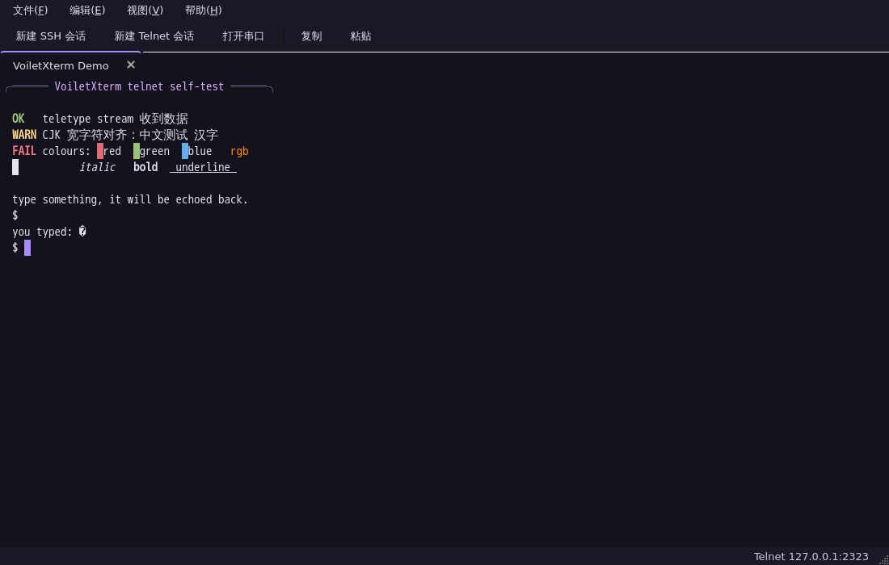

# VoiletXterm

> 轻量的 SSH / Telnet / 串口终端工作台。Qt 5 + qmake，终端内核全部自研。



MobaXterm 很好用，但只跑 Windows、源码闭源。VoiletXterm 只做三件事——**SSH、Telnet、串口**——用一套自己写的 VT100/xterm 内核把它们塞进同一个窗口，三平台共用一套 C++ 代码。

## 特性

**终端内核（自研，不依赖任何终端控件）**
- VT100/xterm 转义序列：CSI / OSC / DCS、SGR 256 色与真彩色、滚动区、插入/删除行列、DEC 特殊字符集
- 备用屏：`vim`、`htop`、`less` 正常工作；5000 行回滚
- CJK 宽字符、组合字符、彩色 emoji、粗体/斜体/下划线/删除线/反色
- 鼠标选区（单击拖动 / 双击选词 / 三击选行）、中键粘贴、自动复制
- 完整键位编码：方向键（含 DECCKM）、F1–F12、Home/End、`Ctrl+字母`、`Alt` 前缀、xterm 修饰符
- 中文输入法走 `inputMethodEvent`，候选窗跟随光标

**三种连接**

| 类型 | 实现 | 说明 |
| --- | --- | --- |
| SSH | 系统 `ssh` 跑在伪终端上（POSIX 用 `forkpty`，Windows 用 ConPTY） | `~/.ssh/config`、密钥、agent、`ProxyJump`、known_hosts、二次验证全部照常生效 |
| Telnet | 内置 IAC 协商 | 自动回 `WILL/DO`，支持 NAWS 窗口尺寸随窗口变化 |
| 串口 | QSerialPort | 波特率 / 数据位 / 校验 / 停止位 / 流控 / 本地回显 |

**界面**
- 左侧固定会话栏（宽度可拖动并记住），双击已保存的会话即可连接
- 多标签会话，标签标题跟随远端 `OSC 0/2` 标题
- 会话保存与复用（QSettings 持久化），新建/编辑/删除
- 命令行直达：`voiletxterm user@host:22` / `telnet://host:port` / `serial:/dev/ttyUSB0@115200`
- 界面有浅色 / 深色两套主题（可跟随系统或按时间自动切换），**终端始终黑底白字**，Ctrl+滚轮缩放字号
- **内置 JetBrains Mono NL 字体**（SIL OFL 1.1），界面和终端统一使用，三平台外观一致，不需要用户自己装字体
  - 正文 Regular，按钮 Medium，标签页 SemiBold，终端可单独在「视图 → 字体」里调
- SSH 密码可以存进系统钥匙串，下次直接登录（见下文）

## 构建

需要 Qt 5.15（Widgets / Network / SerialPort 三个模块）。

```bash
export PATH=/path/to/Qt/5.15.2/gcc_64/bin:$PATH
mkdir -p build && cd build
qmake ../VoiletXterm.pro
make -j$(nproc)
./voiletxterm
```

串口需要读写权限，通常把用户加进 `dialout` 组：`sudo usermod -aG dialout $USER`。

Windows 直接用 Qt Creator 打开 `VoiletXterm.pro`（Kit 选 Desktop Qt 5.15.2 MinGW 64-bit）即可编译。PATH 里需要有 OpenSSH 客户端（`ssh.exe`，Win10/11 默认自带）。

Windows 上默认走 **ConPTY**（Windows 10 1809+）：真正的伪终端，窗口缩放会同步到远端。如果系统不支持 ConPTY，或它 2.5 秒内没有产生数据，会自动退回**管道 + `ssh -tt`** 方案（可用，但远端尺寸固定）。`--pipes` 可强制使用管道方案，`--conpty` 可强制 ConPTY。

## 使用

```bash
voiletxterm                          # 打开会话窗口
voiletxterm root@10.0.0.5:2222       # 直接 SSH
voiletxterm telnet://192.168.1.1     # 直接 Telnet
voiletxterm serial:/dev/ttyUSB0@115200
```

| 快捷键 / 菜单 | 作用 |
| --- | --- |
| 视图 → 字体… | 选字体和字号（会记住） |
| `Ctrl+Shift+N` | 新建 SSH 会话 |
| `Ctrl+Shift+W` | 关闭当前标签 |
| `Ctrl+Shift+C` / `Ctrl+Shift+V` | 复制 / 粘贴 |
| `Ctrl++` / `Ctrl+-` / `Ctrl+0` | 放大 / 缩小 / 重置字号 |

> 所有应用快捷键都带 `Shift`，是为了不抢 shell 的 `Ctrl+N`（下一条历史）、`Ctrl+W`（删除前一个词）这类键位；`Tab`、`Alt+字母`、方向键等也全部原样送给远端。

### 主题

**视图 → 主题** 里四选一，选择会写进配置、下次启动沿用：

| 选项 | 行为 |
| --- | --- |
| 跟随系统（默认） | Windows 读注册表 `Personalize\\AppsUseLightTheme`；macOS 读 `defaults read -g AppleInterfaceStyle`；Linux 依次尝试 **XDG 桌面门户**（GTK4 / KDE 的标准做法）→ `GTK_THEME` 环境变量 → KDE 会话下的 `kdeglobals` → GTK `color-scheme` / `gtk-theme` 设置 → `kdeglobals` 兜底，最后才按 Qt 调色板亮度判断 |
| 按时间自动 | 6:00–18:00 浅色，其余时间深色；每 30 秒复核一次，跨过整点自动切换 |
| 深色 | 深灰底白字 |
| 浅色 | 白底黑字，强光环境或投影时用 |

> 主题只影响界面外壳（标签、工具栏、对话框）。终端本身固定用黑底白字，浅色界面下也不会变成白底——白色终端长时间盯着太难受。

命令行可以临时覆盖、不写入配置：

```bash
voiletxterm --theme light     # system | auto | light | dark
```

## 结构

```
src/core/     Screen、Cell、VtParser、字符宽度、调色板   ← 只依赖 QtCore，可无头测试
src/term/     TerminalWidget（QPainter 渲染）、主题
src/session/  Transport 抽象、PtyProcess、SSH/Telnet/串口实现
src/ui/       MainWindow、SessionDialog、会话存储、样式
tests/        test_core（转义序列）、test_widget（离屏渲染 + 键位编码）
```

终端内核和界面完全解耦：`src/core` 只依赖 QtCore，测试可以直接跑在无显示环境里。

## 设计取舍

**为什么 SSH 用系统 `ssh` 而不是内嵌协议库？**
SSH 客户端最难的不是握手，而是把密钥、agent、跳板、known_hosts、二次验证这些琐事处理对。系统 OpenSSH 已经替我们做了二十年。VoiletXterm 用 `forkpty` 起一个 `ssh`，窗口尺寸通过 `TIOCSWINSZ` 同步，密码提示、主机指纹确认直接显示在终端里——所见即系统 ssh 的所见。

代价是依赖系统的 `ssh`（Linux/macOS 自带；Windows 需要 OpenSSH 客户端）。密码可以通过 `SSH_ASKPASS` 交给它，所以"保存密码"这条路是通的，见下文。

**为什么不做 X11 转发和 RDP？**
这两个经常和 MobaXterm 一起被提起，但它们和"终端"是两套东西：

- **X11 转发**：SSH 协议里有一条 X11 channel。远端程序绘图时不是直接画在屏幕上，而是把绘图指令发给 X server；X11 转发就是把这条 channel 接到本机的 X server，于是远端的图形窗口出现在你本地。它要求本机有 X server（Windows 没有，所以 MobaXterm 自己内置了一个），并且每个窗口都要走 SSH 传输，延迟明显。
- **RDP**：远程桌面协议，把整台 Windows 桌面（画面 + 键盘鼠标）传过来，本质是"远程桌面会话"，和终端无关。它在 MobaXterm 里只是一个内置的 RDP 客户端。

VoiletXterm 的定位是**纯终端工具**：SSH / Telnet / 串口 + 文件传输。要做 X11 就得维护一整套 X server 分发与窗口嵌入，要做 RDP 就得内嵌一个完整的桌面客户端，两者都和"轻量、单二进制"冲突，所以不做。真要图形：Linux/macOS 直接用系统自带的 `ssh -X`，Windows 用系统 RDP 客户端或 WSLg。

**为什么不用 qtermwidget？**
它是 GPL-2.0，一旦引入整个项目就得按 GPL 发布；而且 Konsole 血统的 QPainter 路径限制了性能上限。自研内核约 2000 行，MIT 无约束，问题也能自己修。

**字体与对齐**
字体随二进制分发（JetBrains Mono NL），不再依赖系统装了什么。格子宽度按整像素取整，并用 `letterSpacing` 补偿字体本身的步进，保证每列都落在整像素上——否则每隔一列的字会落在半像素上，看着发虚。

### 保存密码

SSH 页可以填密码并勾选「保存密码」。密码不会写进会话配置，而是交给系统钥匙串：

| 平台 | 存储 |
| --- | --- |
| Windows | DPAPI（当前用户） |
| macOS | Keychain |
| Linux | libsecret（`secret-tool`）；没有则退化为 `~/.config/VoiletXterm/vault.key` 的本地弱加密 |

连接时通过 `SSH_ASKPASS` 把密码交给 ssh（`SSH_ASKPASS_REQUIRE=force`，需要 OpenSSH 8.4+），密码不再显示在终端里。

## 打包

版本号写在 `VoiletXterm.pro` 的 `VERSION` 里，下面这些脚本会读它。

| 平台 | 产物 | 入口 |
| --- | --- | --- |
| Linux | `.deb` / `.rpm` | `packaging/build-deb.sh`、`packaging/build-rpm.sh` |
| Windows | NSIS 安装包 + 便携 zip | `packaging/windows/installer.nsi` + `windeployqt` |
| macOS | `.dmg`（arm64 / x86_64） | `packaging/macos/build-dmg.sh` + `bundle-libs.sh` |

Linux 本地打包：

```bash
mkdir -p build && cd build
qmake ../VoiletXterm.pro CONFIG+=release && make -j$(nproc)
make install INSTALL_ROOT="$PWD/stage"
cd .. && ./packaging/build-deb.sh build/stage 0.1.0 amd64 dist
```

CI 在 `.github/workflows/package.yml`：推 `main` 或打 `v*` tag 时四个平台并行构建，最后汇总挂到 GitHub Release（附 `SHA256SUMS`）。GitHub 之外（比如 Gitea）会自动跳过所有 job。

> **推 main 和打 tag 都会发布**。但要注意 tag 的来源：Gitea 的 push mirror 是 `--mirror` 强推，会 prune 掉"只在 GitHub 存在"的 tag，而 GitHub 的规则是 **tag 没了，Release 就被打回草稿**。
>
> 所以要么在 Gitea 上打 tag（镜像会带过来）：
> ```bash
> git tag -a v0.1.1 -m "release 0.1.1" && git push origin v0.1.1
> ```
> 要么配一个 `GITEA_TOKEN` secret，让工作流把自动生成的 tag 推回 Gitea。两者都不做的话，草稿问题会回来。

## 已知限制

- Windows 上 ConPTY 与管道两套后端都已实测；ConPTY 不可用时自动退回管道（后者远端尺寸固定）
- Linux 上走 Wayland 还是 XWayland 交给发行版决定（不硬设 `QT_QPA_PLATFORM`）；deb/rpm 都 Recommends 了 Qt 的 Wayland 平台插件
- macOS 用 `util.h` 的 `forkpty`，未实机测试
- 没有标签内搜索、没有分屏
- **不做 X11 转发和 RDP**（原因见「设计取舍」）
- SFTP 面板在规划中（见路线图）

## 路线图

- [x] 自研 VT100/xterm 内核、SSH / Telnet / 串口、会话管理
- [x] 深浅色主题、内置字体、整像素网格
- [x] SSH 密码保存（系统钥匙串）
- [ ] **SFTP 文件面板**：按会话挂一个文件区，列目录（`find -printf` 解析）、下载 / 上传（`scp`）、删除、重命名、新建目录，复用同一个 ssh 的认证配置
- [ ] 标签内搜索
- [ ] 分屏

## 许可

代码 MIT。

内置字体 [JetBrains Mono NL](https://github.com/JetBrains/JetBrainsMono) 采用 SIL Open Font License 1.1，
许可证全文见 `resources/fonts/OFL.txt`（安装包中位于 `/usr/share/doc/voiletxterm/OFL.txt`）。
