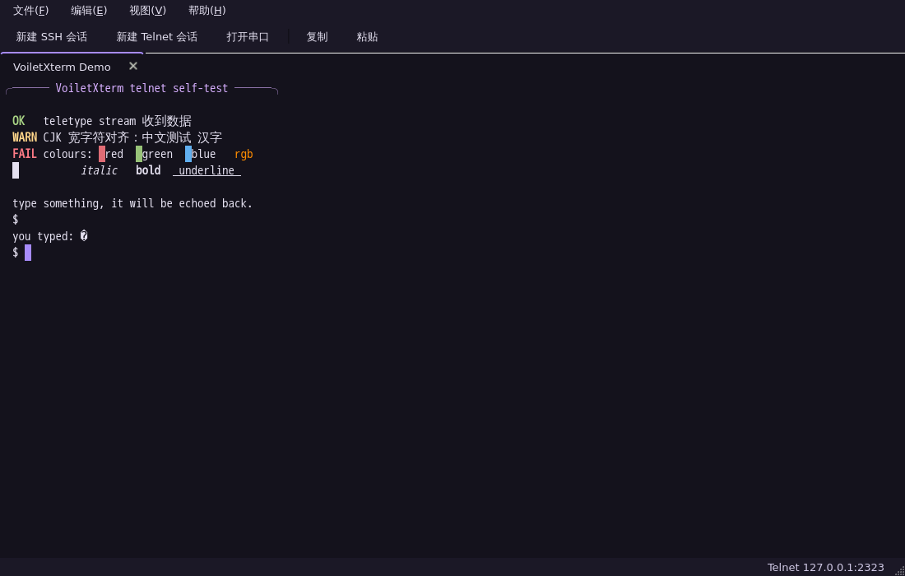

# VoiletXterm

> 轻量的 SSH / Telnet / 串口终端工作台。Qt 5 + qmake，终端内核全部自研。



MobaXterm 很好用，但只跑 Windows、源码闭源。VoiletXterm 只做三件事——**SSH、Telnet、串口**——用一套自己写的 VT100/xterm 内核把它们塞进同一个窗口，三平台共用一套 C++ 代码。

## 特性

**终端内核（自研，不依赖任何终端控件）**
- VT100/xterm 转义序列：CSI / OSC / DCS、SGR 256 色与真彩色、滚动区、插入/删除行列、DEC 特殊字符集
- 备用屏：`vim`、`htop`、`less` 正常工作；5000 行回滚
- CJK 宽字符、组合字符、彩色 emoji、粗体/斜体/下划线/删除线/反色
- 鼠标选区（单击拖动 / 双击选词 / 三击选行）、中键粘贴、自动复制
- 完整键位编码：方向键（含 DECCKM）、F1–F12、Home/End、`Ctrl+字母`、`Alt` 前缀、xterm 修饰符
- 中文输入法走 `inputMethodEvent`，候选窗跟随光标

**三种连接**

| 类型 | 实现 | 说明 |
| --- | --- | --- |
| SSH | 系统 `ssh` 跑在伪终端上（POSIX 用 `forkpty`，Windows 用 ConPTY） | `~/.ssh/config`、密钥、agent、`ProxyJump`、known_hosts、二次验证全部照常生效 |
| Telnet | 内置 IAC 协商 | 自动回 `WILL/DO`，支持 NAWS 窗口尺寸随窗口变化 |
| 串口 | QSerialPort | 波特率 / 数据位 / 校验 / 停止位 / 流控 / 本地回显 |

**界面**
- 多标签会话，标签标题跟随远端 `OSC 0/2` 标题
- 会话保存与复用（QSettings 持久化），新建/编辑/删除
- 命令行直达：`voiletxterm user@host:22` / `telnet://host:port` / `serial:/dev/ttyUSB0@115200`
- 浅色 / 深色两套主题，可跟随系统或按时间自动切换（见下文），Ctrl+滚轮缩放字号

## 构建

需要 Qt 5.15（Widgets / Network / SerialPort 三个模块）。

```bash
export PATH=/path/to/Qt/5.15.2/gcc_64/bin:$PATH
mkdir -p build && cd build
qmake ../VoiletXterm.pro
make -j$(nproc)
./voiletxterm
```

串口需要读写权限，通常把用户加进 `dialout` 组：`sudo usermod -aG dialout $USER`。

Windows 直接用 Qt Creator 打开 `VoiletXterm.pro`（Kit 选 Desktop Qt 5.15.2 MinGW 64-bit）即可编译。PATH 里需要有 OpenSSH 客户端（`ssh.exe`，Win10/11 默认自带）。

Windows 上的 SSH 默认走**管道 + `ssh -tt`**：远端会分配伪终端，输出经管道回到界面。代价是**远端终端尺寸固定**（ssh 在没有本地 tty 时按 80×24 申请），拖动窗口不会重排。ConPTY 后端已经写好但默认关闭（`--conpty` 可试验），因为在实测中它没能把子进程的标准输出接到我们的管道上。

## 使用

```bash
voiletxterm                          # 打开会话窗口
voiletxterm root@10.0.0.5:2222       # 直接 SSH
voiletxterm telnet://192.168.1.1     # 直接 Telnet
voiletxterm serial:/dev/ttyUSB0@115200
```

| 快捷键 | 作用 |
| --- | --- |
| `Ctrl+N` | 新建 SSH 会话 |
| `Ctrl+W` | 关闭当前标签 |
| `Ctrl+Shift+C` / `Ctrl+Shift+V` | 复制 / 粘贴 |
| `Ctrl++` / `Ctrl+-` / `Ctrl+0` | 放大 / 缩小 / 重置字号 |

### 主题

**视图 → 主题** 里四选一，选择会写进配置、下次启动沿用：

| 选项 | 行为 |
| --- | --- |
| 跟随系统（默认） | Windows 读注册表 `Personalize\\AppsUseLightTheme`，macOS 读 `defaults read -g AppleInterfaceStyle`，Linux 读 GNOME `color-scheme` / `gtk-theme`；都取不到时按 Qt 调色板亮度兜底 |
| 按时间自动 | 6:00–18:00 浅色，其余时间深色；每 30 秒复核一次，跨过整点自动切换 |
| 浅色 / 深色 | 强制其中一种 |

命令行可以临时覆盖、不写入配置：

```bash
voiletxterm --theme light     # system | auto | light | dark
```

## 结构

```
src/core/     Screen、Cell、VtParser、字符宽度、调色板   ← 只依赖 QtCore，可无头测试
src/term/     TerminalWidget（QPainter 渲染）、主题
src/session/  Transport 抽象、PtyProcess、SSH/Telnet/串口实现
src/ui/       MainWindow、SessionDialog、会话存储、样式
tests/        test_core（转义序列）、test_widget（离屏渲染 + 键位编码）
```

终端内核和界面完全解耦：`src/core` 只依赖 QtCore，测试可以直接跑在无显示环境里。

## 设计取舍

**为什么 SSH 用系统 `ssh` 而不是内嵌协议库？**
SSH 客户端最难的不是握手，而是把密钥、agent、跳板、known_hosts、二次验证这些琐事处理对。系统 OpenSSH 已经替我们做了二十年。VoiletXterm 用 `forkpty` 起一个 `ssh`，窗口尺寸通过 `TIOCSWINSZ` 同步，密码提示、主机指纹确认直接显示在终端里——所见即系统 ssh 的所见。

代价是依赖系统的 `ssh`（Linux/macOS 自带），以及无法做程序化的密码保管。

**为什么不用 qtermwidget？**
它是 GPL-2.0，一旦引入整个项目就得按 GPL 发布；而且 Konsole 血统的 QPainter 路径限制了性能上限。自研内核约 2000 行，MIT 无约束，问题也能自己修。

**宽字符对齐**
默认字体优先选半角/全角宽度严格 1:2 的字体（Sarasa Mono SC、文泉驿等宽正黑），这样 `中` 正好占两格；找不到再退回 DejaVu Sans Mono。

## 已知限制

- Windows 已实测可用（SSH 走管道 + `ssh -tt`），但**远端终端尺寸固定**（默认 80×24），拖动窗口不会重排
- ConPTY 后端已实现但默认关闭（`--conpty`）：实测中它挂上了控制台，却没把子进程的标准输出接到我们的管道
- macOS 用 `util.h` 的 `forkpty`，未实机测试
- 没有 SFTP 文件面板、没有 X11 转发、没有 RDP（MobaXterm 的那部分不在当前范围）
- 没有标签内搜索、没有分屏
- SSH 密码登录在终端里交互，不经过独立密码框

## 许可

MIT
